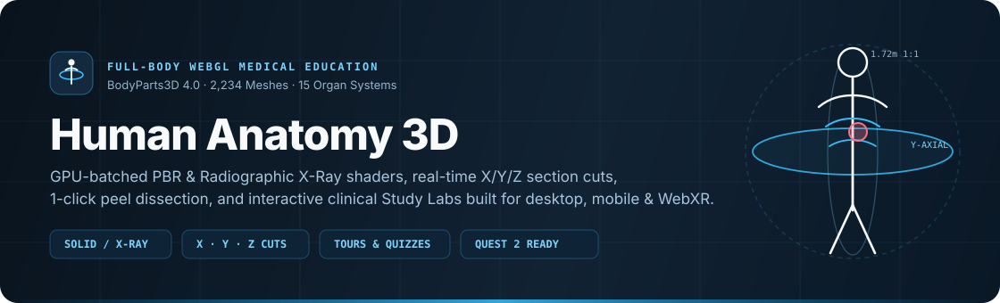
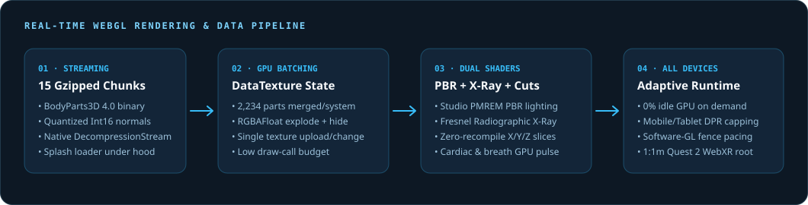
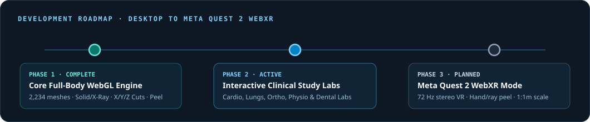

<p align="center">
  
</p>

<p align="center">
  <strong>Human Anatomy 3D</strong> is a high-performance, browser-based full-body anatomical learning platform spanning <strong>2,234 adult structures</strong> across <strong>15 organ systems</strong> — engineered with GPU-batched Solid PBR &amp; Radiographic X-Ray shaders, real-time anatomical section cuts, one-click peel dissection, and interactive clinical Study Labs.
</p>

<p align="center">
  
  
  
  
  
</p>

---

## Core Capabilities

| Feature | Description |
| :--- | :--- |
| **Full-Body 3D Dataset** | Complete adult reference anatomy (**2,234 meshes**, **3,432 searchable FMA concepts**, **15 systems**). |
| **Solid PBR & Radiographic X-Ray Toggle** | Instant zero-hitch toggle between calibrated studio PBR shading and depth-independent Fresnel X-Ray translucency. |
| **Real-Time Section Cuts (`X · Y · Z`)** | GPU fragment slicing across **Sagittal (X)**, **Axial (Y)**, and **Coronal (Z)** planes with cut-edge highlighting, direction flip, and clipped raycasting so you can click exposed internal organs directly. |
| **Fast Peel Dissection & Undo** | Turn on **Peel Mode (`P`)** or hold **`Shift + Click`** on any mesh to hide it immediately. Press **`H`** to hide selected, **`U`** to undo the last hide, or click **Unhide All** in the bottom dock. |
| **Interactive Clinical Study Labs** | Dedicated **Guided 3D Tours**, **3D Identification Quizzes** (answer by clicking the 3D organ or selecting an option), and procedural GPU **Cardiac Pulse (72 BPM)** & **Breathing Cycle** animations across Cardiology, Pulmonology, Orthopedics, Physiotherapy, and Dentistry. |
| **Two-Stage Explode Anatomy** | Smoothly separates organ systems radially (`0–45%`) before organizing all visible parts into a non-overlapping flat anatomical catalog (`45–100%`). |
| **Live Camera X-Ray Mirror** | Optional webcam mirror mode overlaying translucent radiographic skeletal structures. |

---

## WebGL Performance Architecture

Designed from the ground up to maintain smooth frame rates on phones, tablets, laptops, and standalone VR headsets:

<p align="center">
  
</p>

- **GPU-Batched Geometry**: Meshes are merged per anatomical system so all 2,234 structures render in a minimal draw-call budget.
- **RGBAFloat `DataTexture` Updates**: Per-part visibility, selection highlight, and explode offsets upload to the GPU in a single compact texture pass—zero geometry rebuilding.
- **Zero-Recompile Shaders**: Section cuts (`X`, `Y`, `Z`) and physiological pulse animations run via shared uniforms inside both Solid PBR and X-Ray shaders.
- **Demand-Driven Rendering**: Consumes **0% GPU** when the camera and animations are idle; includes adaptive mobile/tablet DPR caps (`Auto GPU`, `High 2x`, `Tablet 1.5x`, `Eco 1x`) and software-WebGL fence pacing.

---

## Keyboard Shortcuts

| Key | Action |
| :---: | :--- |
| `/` | Open spotlight search across all 3,432 FMA anatomical concepts |
| `X` | Toggle between **Solid PBR** and **Radiographic X-Ray** shaders |
| `P` | Toggle **Peel Quick-Hide Mode** (or hold `Shift + Click` any structure) |
| `H` | Hide currently selected structure |
| `U` | Undo last hide (instant unhide) |
| `L` | Toggle the right Systems & Study Focus drawer |
| `R` | Reset camera, section cuts, explode slider, and layers |
| `Esc` | Exit Peel Mode, close dialogs, or clear selection |

---

## Roadmap (Desktop, Mobile & Meta Quest 2 WebXR)

<p align="center">
  
</p>

### Meta Quest 2 WebXR Readiness
The Three.js scene mounts all batched anatomical geometry under an explicit `HumanAnatomyRoot` group authored in **1:1 real-world meters** (~1.72 m adult standing height, floor plane at `y = 0`), matching the WebXR `local-floor` reference space directly. Combined with low draw-call system batching and `src/utils/webxrReady.ts`, transitioning to 72 Hz stereo Quest 2 WebXR with controller/hand-tracking peel dissection requires no geometry re-authoring.

---

## Local Development

### Prerequisites
- **Node.js 20+** and **npm**

### Install & Run
```bash
npm install
npm run dev
```
Open `http://localhost:3000` in any WebGL2-capable browser.

### Build, Type-Check & Unit Tests
```bash
# Run pure logic unit tests (section cuts, visibility precedence, search, quiz engine)
npx --yes tsx --test src/utils/fullBodyLogic.test.ts

# TypeScript check
npm run lint

# Production bundle
npm run build
```

---

## Project Structure

```text
├── public/
│   ├── favicon.svg              # Geometric anatomical cross-section favicon
│   ├── og-card.svg              # OpenGraph / Twitter social share preview
│   ├── site.webmanifest         # Sanitized Web App Manifest
│   └── models/                  # BodyParts3D 4.0 manifest + 15 gzipped binary chunks
├── docs/assets/                 # Thematic README SVGs (banner, architecture, roadmap)
├── src/
│   ├── App.tsx                  # Main clinical studio layout & state orchestration
│   ├── components/
│   │   ├── FullBodyViewport.tsx # GPU-batched Three.js engine (PBR, X-Ray, Cuts, Motion)
│   │   ├── SplashScreen.tsx     # Full-viewport clinical preloader
│   │   ├── LayersDrawer.tsx     # Right Systems, Hidden manager & Study Focus drawer
│   │   ├── StudyLabPanel.tsx    # Guided 3D tours & interactive 3D identification quizzes
│   │   ├── StructureSheet.tsx   # Contextual structure inspector
│   │   ├── SearchPopover.tsx    # Ranked 3,432-concept search spotlight
│   │   └── XRayMirrorView.tsx   # Optional webcam X-Ray mirror mode
│   ├── data/
│   │   ├── fullBodyAnatomy.ts   # 15 organ systems, tracks & clinical notes
│   │   └── studyCurriculum.ts   # Specialty guided tours & 3D quiz bank
│   └── utils/
│       ├── fullBodyLogic.ts     # Pure math: section cuts, layout packing, search, quiz
│       ├── fullBodyLogic.test.ts# Node built-in unit tests
│       └── webxrReady.ts        # Quest 2 WebXR metric config & capability probe
└── index.html                   # Full SEO metadata, OpenGraph, Twitter & JSON-LD schema
```

---

## Credits & Licensing

- **3D Anatomical Models**: **BodyParts3D 4.0** © The Database Center for Life Science (DBCLS), licensed under [CC BY 4.0](https://creativecommons.org/licenses/by/4.0/).
- **Batched Binary Chunk Pipeline**: Inspired by [ashemag/human-atlas](https://github.com/ashemag/human-atlas).
- **Disclaimer**: Built strictly for visual anatomical education and study—not intended for clinical diagnosis or medical treatment.
